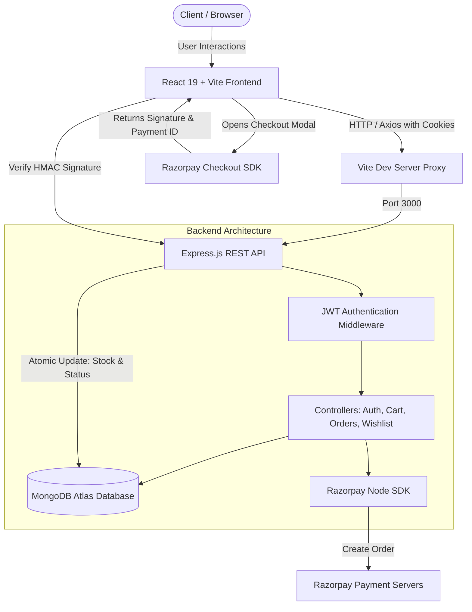

# 🛒 ShopKart — Modern Full-Stack E-Commerce & Payment Platform

[](https://nodejs.org/)
[](https://expressjs.com/)
[](https://react.dev/)
[](https://vitejs.dev/)
[](https://www.mongodb.com/atlas)
[](https://razorpay.com/)
[](https://jwt.io/)

A production-grade, full-stack E-Commerce web application engineered with a modern **MERN architecture**, featuring **Razorpay Payment Gateway integration**, secure **JWT cookie-based authentication**, real-time **stock decrementing**, and a responsive **React 19 single-page interface**.

---

## 📑 Table of Contents

- [Architectural Overview](#-architectural-overview)
- [Key Features](#-key-features)
- [Technology Stack](#-technology-stack)
- [Project File Structure](#-project-file-structure)
- [Razorpay Payment Workflow](#-razorpay-payment-workflow)
- [Step-by-Step Setup Guide](#-step-by-step-setup-guide)
  - [Prerequisites](#prerequisites)
  - [1. Clone Repository](#1-clone-the-repository)
  - [2. Backend Setup & Configuration](#2-backend-setup--configuration)
  - [3. Database Seeding](#3-seed-database-with-sample-products)
  - [4. Frontend Setup](#4-frontend-setup)
- [REST API Reference](#-rest-api-reference)
- [Security & Production Best Practices](#-security--production-best-practices)
- [Author & License](#-author--license)

---

## 🏛️ Architectural Overview

ShopKart follows the **Separation of Concerns (SoC)** and **Model-View-Controller (MVC)** design patterns. The backend Express API operates as a decoupled REST service interfacing with MongoDB Atlas and Razorpay, while the React frontend communicates via an authenticated HTTP layer with automated proxy routing.



---

## ✨ Key Features

### 🔐 1. Authentication & Session Management
- **Stateless JWT with HTTP-Only Cookies**: Protected from cross-site scripting (XSS) token theft.
- **Bcrypt Hashing**: Passwords salted and hashed with 10 rounds before persistence.
- **Route Guards**: Protected frontend navigation and Express middleware authentication guards (`authenticate`).

### 🛍️ 2. Dynamic Catalog & Inventory Control
- **Real-Time Stock Checks**: Prevents checkout when requested quantities exceed available inventory.
- **Atomic Stock Decrementing**: Inventory automatically updates upon verified payment completion.
- **Rich Product Meta**: Multi-category tagging, dynamic pricing, and high-resolution asset displays.

### 🛒 3. Cart & Wishlist Synchronization
- **Server-Side Persistence**: Cart and wishlist items are synced to the customer's database document, persisting across sessions and devices.
- **Context API State**: Optimistic UI updates with instant feedback across the navigation bar, badge counts, and checkout totals.

### 💳 4. Razorpay Payment Integration
- **Two-Phase Payment Handshake**: 
  1. Backend generates an official Razorpay order with server-calculated totals.
  2. Frontend opens the Razorpay modal.
  3. On completion, backend validates the payment cryptographically using `HMAC-SHA256`.
- **Order State Machine**: Transitions cleanly across `PENDING_PAYMENT` ➔ `PLACED` ➔ `CONFIRMED` ➔ `SHIPPED` ➔ `DELIVERED`.

---

## 🛠️ Technology Stack

| Layer | Technologies |
| :--- | :--- |
| **Frontend** | React 19, Vite 8, React Router v7, Lucide Icons, Vanilla CSS Design System |
| **Backend** | Node.js, Express.js 5, Cookie Parser, Dotenv |
| **Database** | MongoDB Atlas, Mongoose ODM |
| **Payment Gateway** | Razorpay Node SDK, Razorpay Checkout.js |
| **Security** | JSON Web Tokens (`jsonwebtoken`), `bcrypt`, `crypto` (HMAC-SHA256) |

---

## 📂 Project File Structure

```text
ShopKart/
├── config/
│   └── razorpay.js              # Razorpay SDK initialization & singleton instance
├── controllers/
│   ├── customer.controller.js   # Customer register, login, logout, profile
│   ├── product.controller.js    # Catalog queries, search, and product details
│   ├── cart.controller.js       # Add/update/remove cart items with stock validation
│   ├── wishlist.controller.js   # Wishlist toggle and fetching
│   └── order.controller.js      # Razorpay order generation, HMAC verification, lifecycle
├── middlewares/
│   └── auth.middleware.js       # JWT cookie extraction and route authentication guard
├── models/
│   ├── customer.model.js        # Customer schema (auth, cart items, wishlist references)
│   ├── product.model.js         # Product schema (stock, pricing, image, category)
│   └── order.model.js           # Order schema (items snapshot, address, Razorpay metadata)
├── routes/
│   ├── customer.routes.js       # /customers endpoints
│   ├── product.routes.js        # /products endpoints
│   ├── cart.routes.js           # /cart endpoints
│   ├── wishlist.routes.js       # /wishlist endpoints
│   └── order.routes.js          # /orders endpoints (checkout, verify, order status)
├── utils/
│   └── generateToken.js         # JWT signing & HTTP-only cookie configuration
├── SmartKart-Frontend/          # React 19 Single-Page Application
│   ├── src/
│   │   ├── components/          # Reusable UI components (Navbar, ProductCard, CartItem)
│   │   ├── context/             # Global CartContext (cart count, total, actions)
│   │   ├── pages/               # Views: Home, Products, Cart, Checkout, Orders, Wishlist
│   │   ├── services/            # Axios API instances withCredentials configuration
│   │   ├── App.jsx              # Main routing tree and route guards
│   │   ├── App.css              # Glassmorphism & responsive CSS utility system
│   │   └── main.jsx             # React DOM entry point
│   ├── package.json             # Frontend dependencies & Vite scripts
│   └── vite.config.js           # Vite dev server with backend API reverse proxy
├── .env.example                 # Environment variables template for new deployments
├── .gitignore                   # Excludes node_modules, .env, and build artifacts
├── index.js                     # Express application bootstrap & MongoDB connection
├── package.json                 # Backend dependencies & npm scripts (start, dev, seed)
└── seed.js                      # Automated database populator with mock catalog
```

---

## 🔄 Razorpay Payment Workflow

```mermaid
sequenceDiagram
    autonumber
    actor Customer as Customer
    participant Frontend as React Frontend
    participant Backend as Express Backend
    participant Razorpay as Razorpay Gateway
    participant DB as MongoDB Atlas

    Customer->>Frontend: Clicks "Pay with Razorpay"
    Frontend->>Backend: POST /orders/create-payment-order (Shipping Info)
    Backend->>DB: Validate Cart & Calculate Total
    Backend->>Razorpay: razorpay.orders.create({ amount, currency: 'INR' })
    Razorpay-->>Backend: Returns razorpay_order_id
    Backend->>DB: Save initial Order (Status: PENDING_PAYMENT)
    Backend-->>Frontend: Return shopKartOrderId, razorpayOrderId, key_id
    Frontend->>Razorpay: Open Razorpay Checkout Modal
    Customer->>Razorpay: Enters Card / UPI / NetBanking details
    Razorpay-->>Frontend: Returns razorpay_payment_id & razorpay_signature
    Frontend->>Backend: POST /orders/verify-payment
    Backend->>Backend: Compute expected signature: HMAC_SHA256(order_id + '|' + payment_id, secret)
    alt Signature Matches
        Backend->>DB: Set status: PLACED, paymentStatus: PAID
        Backend->>DB: Decrement product stock & Clear customer cart
        Backend-->>Frontend: Return 200 OK (Payment Verified)
        Frontend-->>Customer: Redirect to /order-success/:id
    else Signature Mismatch
        Backend->>DB: Set paymentStatus: FAILED
        Backend-->>Frontend: Return 400 Bad Request
        Frontend-->>Customer: Show error modal; Cart preserved
    end
```

---

## 🚀 Step-by-Step Setup Guide

### Prerequisites
- [Node.js](https://nodejs.org/) (v18.0.0 or higher)
- [MongoDB Atlas Account](https://cloud.mongodb.com/) or local MongoDB instance
- [Razorpay Account](https://dashboard.razorpay.com/) (Test mode keys)

---

### 1. Clone the Repository
```bash
git clone https://github.com/Ramu-9/SmartKart.git
cd SmartKart
```

---

### 2. Backend Setup & Configuration

1. **Install backend dependencies:**
   ```bash
   npm install
   ```

2. **Configure environment variables:**
   Copy `.env.example` to `.env`:
   ```bash
   cp .env.example .env
   ```

3. **Populate your `.env` values:**
   ```env
   PORT=3000
   MONGODB_URI=mongodb+srv://<username>:<password>@cluster0.mongodb.net/shopkart?retryWrites=true&w=majority
   JWT_SECRET=your_super_secret_jwt_key
   JWT_EXPIRES_IN=7d
   RAZORPAY_KEY_ID=rzp_test_your_key_id
   RAZORPAY_KEY_SECRET=your_razorpay_secret_key
   ```

   > [!IMPORTANT]
   > Make sure your current IP address is whitelisted in MongoDB Atlas under **Network Access** → **IP Access List**.

---

### 3. Seed Database with Sample Products
Populate MongoDB with default electronics, fashion, and books:
```bash
npm run seed
```

---

### 4. Frontend Setup

1. **Navigate to the frontend directory:**
   ```bash
   cd SmartKart-Frontend
   ```

2. **Install frontend dependencies:**
   ```bash
   npm install
   ```

3. **Start the frontend development server:**
   ```bash
   npm run dev
   ```

---

### 5. Running Both Servers

- **Backend Server**: Run `npm run dev` in the root directory (`http://localhost:3000`).
- **Frontend App**: Run `npm run dev` inside `SmartKart-Frontend` (`http://localhost:5173`).

---

## 📡 REST API Reference

### 👤 Customer Endpoints (`/customers`)
| Method | Endpoint | Auth | Description |
| :--- | :--- | :---: | :--- |
| `POST` | `/customers/register` | No | Register new user (name, email, password) |
| `POST` | `/customers/login` | No | Authenticate user & issue HTTP-only cookie |
| `POST` | `/customers/logout` | Yes | Clear JWT session cookie |
| `GET` | `/customers/profile` | Yes | Fetch authenticated user profile |

### 📦 Product Endpoints (`/products`)
| Method | Endpoint | Auth | Description |
| :--- | :--- | :---: | :--- |
| `GET` | `/products` | No | Fetch all active products |
| `GET` | `/products/:id` | No | Fetch individual product by ID |

### 🛒 Cart Endpoints (`/cart`)
| Method | Endpoint | Auth | Description |
| :--- | :--- | :---: | :--- |
| `GET` | `/cart` | Yes | Get customer's cart with populated product data |
| `POST` | `/cart/add` | Yes | Add product to cart with quantity validation |
| `PUT` | `/cart/update` | Yes | Update item quantity in cart |
| `DELETE`| `/cart/remove/:productId` | Yes | Remove specific item from cart |

### 💖 Wishlist Endpoints (`/wishlist`)
| Method | Endpoint | Auth | Description |
| :--- | :--- | :---: | :--- |
| `GET` | `/wishlist` | Yes | Get customer's saved wishlist products |
| `POST` | `/wishlist/toggle` | Yes | Add/remove product from wishlist |

### 💳 Order & Payment Endpoints (`/orders`)
| Method | Endpoint | Auth | Description |
| :--- | :--- | :---: | :--- |
| `POST` | `/orders/create-payment-order` | Yes | Validate cart, create DB order & Razorpay order |
| `POST` | `/orders/verify-payment` | Yes | Validate HMAC-SHA256 signature, finalize order & decrement stock |
| `GET` | `/orders` | Yes | Get order history for authenticated user |
| `GET` | `/orders/:id` | Yes | Fetch complete order breakdown & delivery status |
| `PATCH`| `/orders/:id/status` | Yes | Update status (`PENDING_PAYMENT`, `PLACED`, `CONFIRMED`, `SHIPPED`, `DELIVERED`) |

---

## 🔒 Security & Production Best Practices

- **Zero-Secret Leakage**: Sensitive credentials (`.env`) are strictly ignored by `.gitignore`, with `.env.example` provided for safe onboarding.
- **Cryptographic Signature Validation**: Razorpay webhook/client payloads are verified using Node's native `crypto.createHmac('sha256', secret)` to eliminate tampering or forged payment IDs.
- **Strict Input Sanitization**: Form inputs, pincodes, and MongoDB ObjectIDs are strictly validated prior to database queries.
- **Safe Stock Decrementation**: Products are checked for available inventory immediately before order creation and atomically updated upon payment verification.

---

## 📄 License
This project is open-source and available under the [MIT License](LICENSE).
